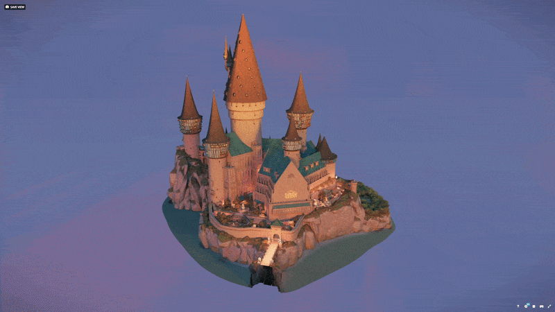

Procedural Northern European French Town in Geometry nodes Blender 5.0
=================

This repo contains nodes for my all geometry nodes project of making the assets for a northern eurpean style town. There is a demo scene, titled magic school v2, show casing an example of use case. In general though the assets are very versatile, you can make many things with it! The demo file is not the most up to date, take the GeometryNodesFrenchHous.blend for the assets! The demo is also on Sketchfab as a mesh for viewing, though in way lower resolution: https://skfb.ly/pOr6q

Here are the geo node assets in the blend file that generate different type of models:

## Practical palette and reuse map

| Family | Main generators | Useful variations and combinations |
|---|---|---|
| Housing | GenerateHouse; HousesOnCurves | cottages, tall merchant houses, dense streets, granaries, inns; generally a house type |
| Towers | Generate Tower; Generate Square Tower; WallTowerround; WindMill | watchtowers, gate flanks, mills, observatories, vertical accents; sail-free mill and tower bottom extensions diversify silhouettes and add options for more fantasy like towers |
| Gothic civic buildings | ChurchA-Front; GenerateChurchBuildingB; ChurchFrontTowers; DomaTower; Generate Cathedral Combined | cathedral, palace, guildhall, cloister, bell tower and monumental gateway |
| Fortifications | TownWall; TownWall_Climbing; CreateGate | terrace ramparts, outer defenses, gate courts; |
| Platforms and circulation | GenerateTerrace; Balkony; MakeStairs; GenerateStairCase; Generate Bridge Stone; Wooden Bridge; Make Dirt Road | squares, retaining platforms, switchbacks, footbridges, service decks and stair shortcuts. Balkonies without base can also be entrances |
| Landscape | Generate Cliff Type A; Generate Cliff Type 2; GenerateRockSlow; GeneratorBoulders; Generate Stones | hill core, escarpments, rocky spine, quarry, foundation outcrops |
| Water | Make River; Waterfall | spring-fed channels, river, cascades and reservoir outlets; custom basin meshes complete cisterns |
| Vegetation and food | MakeTree; Tree On Geo Points; MakeBush; MakeGrass; Distribute Wheat/Corn/Sunflower; Pumpkin | orchard, sheltered courtyard, kitchen gardens, crop fields and windbreaks |
| Street furnishings | Stall; MakeStallCover; GenerateCover; Fence Type A; Banner; HangingBanners; Flag; Pole | markets, covered work yards, awnings, farm enclosure and district heraldry |
| Architectural parts | WindowWalls; WindowFromEdges; CurvedDoorFromEdges; RailsFromEdge; arcs and support columns | palace wings, galleries, arcade fronts and decorative retaining facades |

Beside these there are a lot of supporting geo nodes that make walls, windows, doors, alcoves, flowers, gothinc support beams etc. These can also be used individually as well.

It was written and tested on Blender 5.0. The test machine has a 5090 graphic card, alot of ram and a powerful CPU, so the performance on lower end PCs could be very different compared to the videos.

The nodes are well documented and cleaned up, with viewer nodes in betweens to be able to follow whats happening. At a later date I will release a blog post explaining some of the tricks more in depth.

Here is an example of the baisic houses. You can define the foundation of the house in edit mode. Just make sure you dont apply your tranform if you wanto rotate, scale the house, do it on the object. I am assuming the house is somewhat centered around X axis.

Here is an example of the towers. They are purely GN defined, so their controls is on the modifier. There are two type, the round one and the square one. 

You can also generate rails, terraces and stairs. You have to kind of mix and match those nodes based on your needs.

Overall there are 4 type of assets in there. In some you define the foundation as face. In some you define the mesh volume rouhgly in edit mode. In some you define the dimensions through pure geo node paramters and some are defined by curves. More info on usage below: 

## Working methods

- **Foundation mesh:** houses use an approximately X-symmetrical footprint; local +X is the front/door direction. Change the foundation mesh or native parameters to alter proportions. Bushes, Covers, terraces and cliff generators depend on authored mesh shape.
- **Parametric:** towers, gates, stalls and Gothic buildings expose dimensions and structural controls in the modifier.
- **Curve/edge:** town walls, bridges, roads, rivers, fences, window walls and stairs follow authored paths or edges. Climbing walls and roads can use a ground target.
- **Distribution:** crops, trees, stones and surface points need a host geometry or target. Density is a major cost control.
- **Composition:** combine Gothic fronts, naves, domes and bell towers into palaces; use terraces for courts, viaduct decks and foundations; disable mill sails for a new tower silhouette; use tower lower extensions for hanging buildings. Tilt and extrusion allow whimsical forms, while straight floors suit fortified cities.

